# Evidence

## Check 1: normal behavior
**Refresh BR-001.** Total 5, counts Pending 1 / In transit 2 / Delivered 1 / Exception 1.
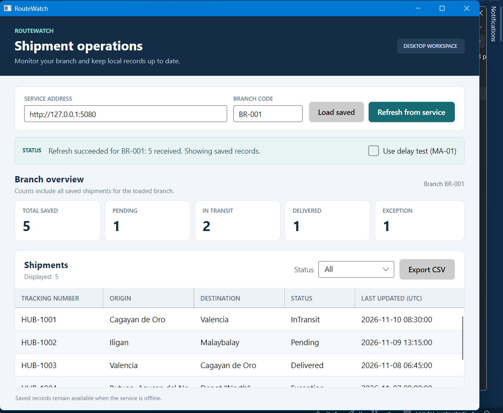

**Branch isolation.** BR-002 "Load saved" shows no BR-001 rows.
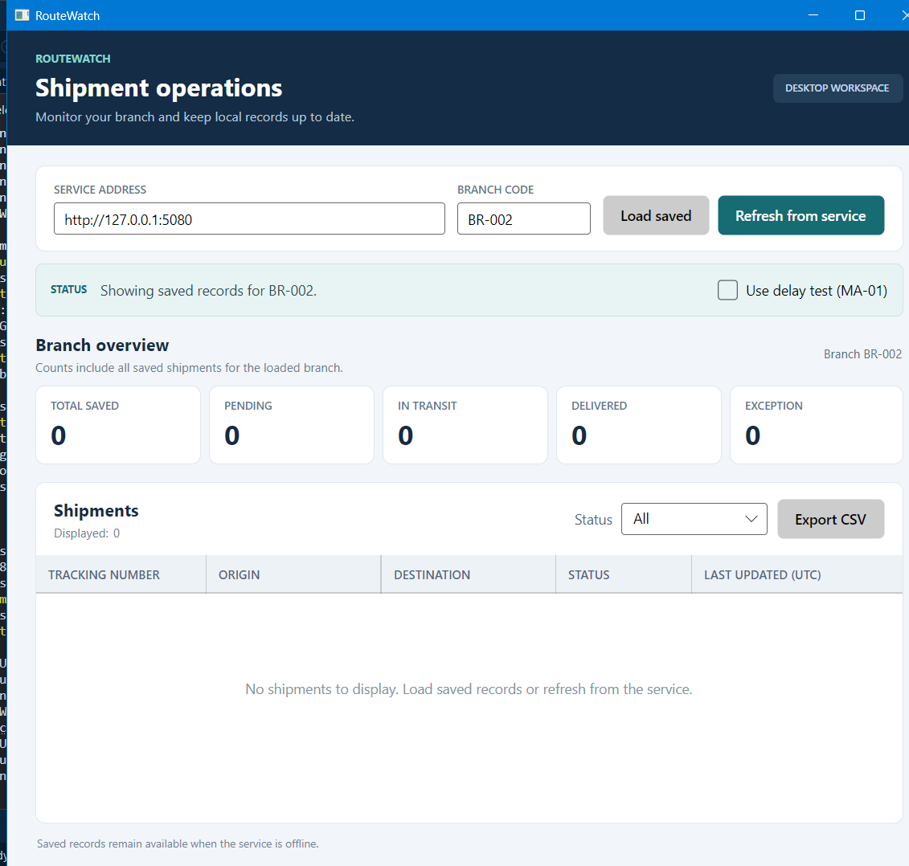

**BR-002 refresh.** 2 shipments received.
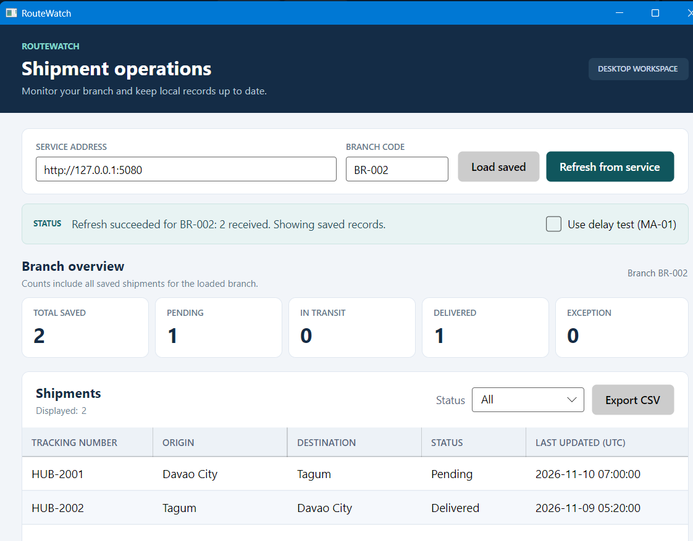

**CSV escaping.** Commas and quotes in fields are quoted correctly.
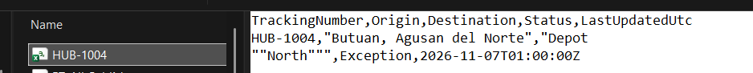

## MA-01: responsive external operations
**Delay test in progress.** "Working...", buttons disabled, saved records visible.
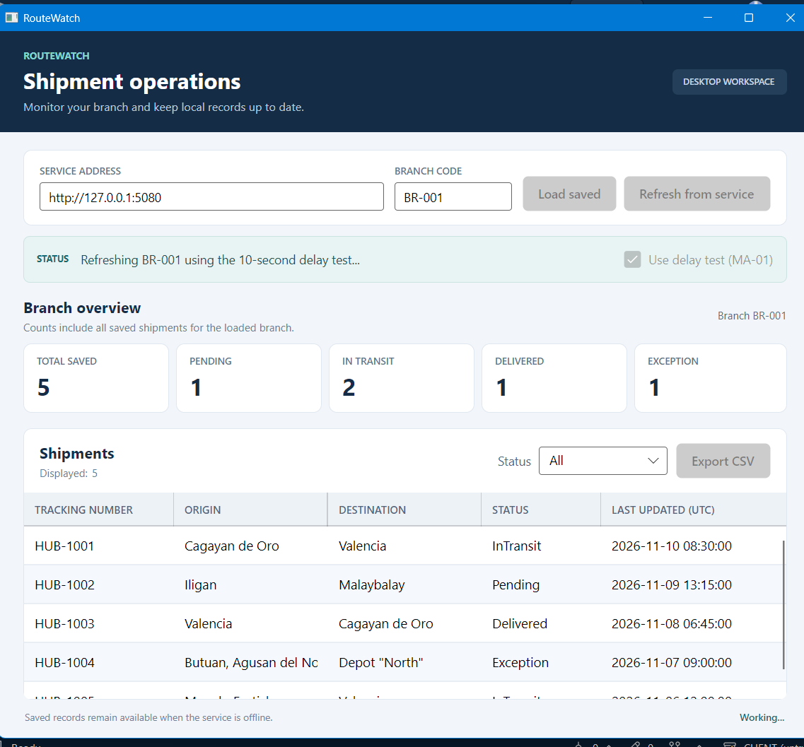

**Delay test finished.**
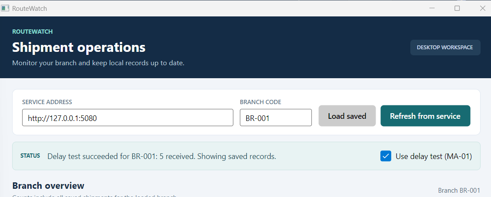

**Service stopped.** Failure reported, saved records unchanged.
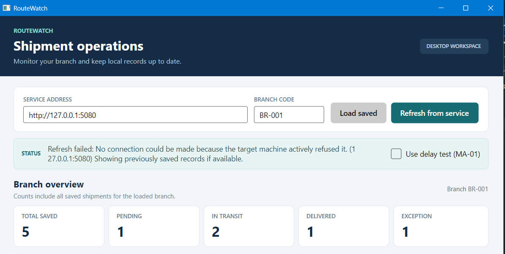

## Defect: startup configuration warning
**Before the fix.** appsettings.json missing, but the status says everything is fine.
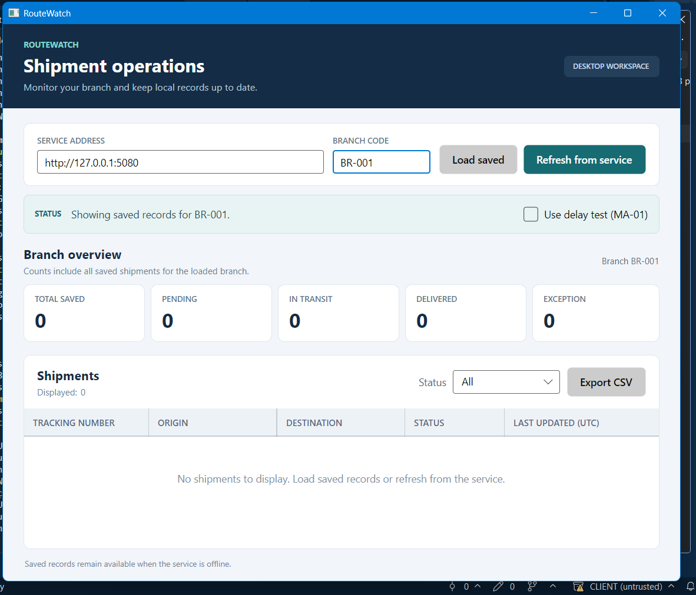

**After the fix.** The warning survives the initial load.
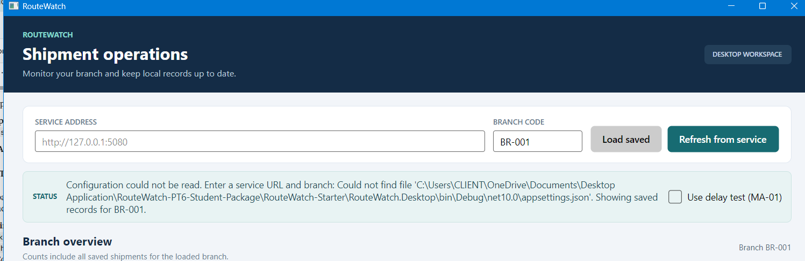

## MA-02: published application
**Published exe launched outside Visual Studio.**
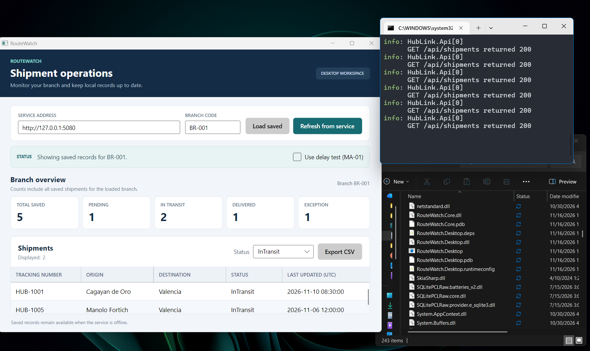

**Refresh and filter in the published exe.**
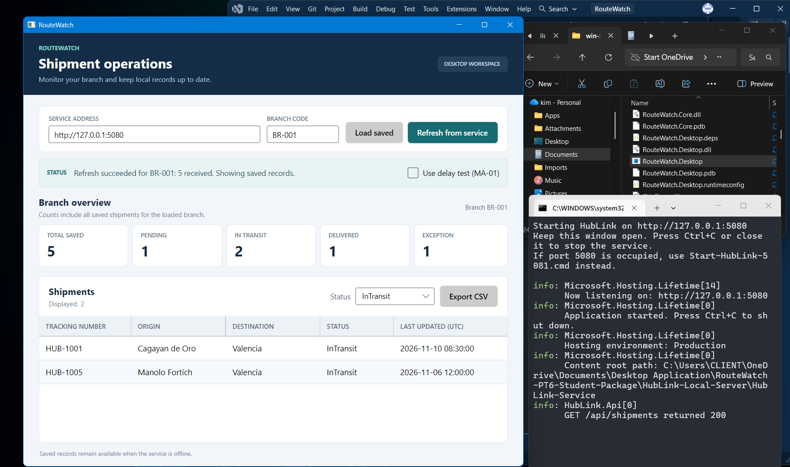

**Export from the published exe matches the grid.**
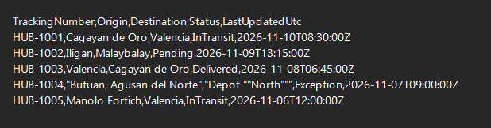

**Publish folder contents.** Executable, configuration and native libraries are present.
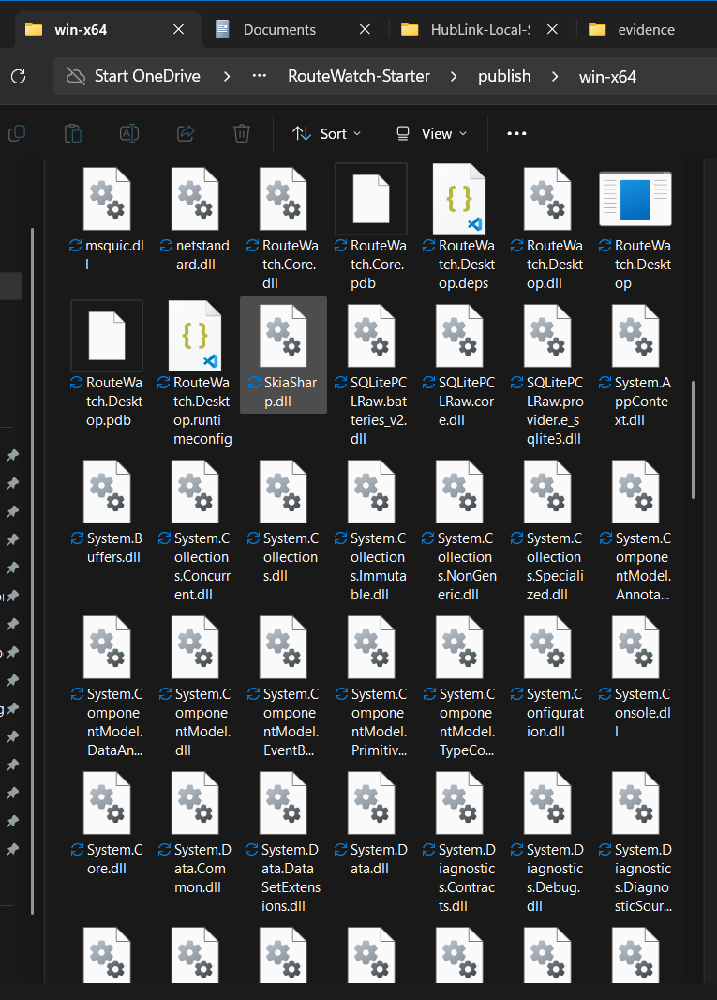